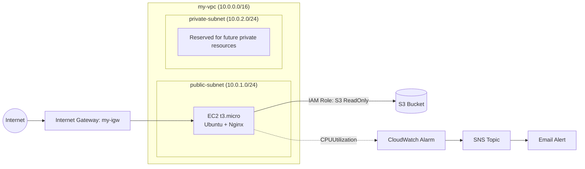

# Secure AWS Web Infrastructure

A hands-on AWS project that builds a secure, monitored web server from scratch: a custom VPC with a public subnet, an Nginx web server on EC2, layered network security (Security Group + NACL), keyless S3 access through an IAM Role (least privilege), and a CloudWatch alarm that sends email alerts through SNS.

**Region:** eu-north-1 (Stockholm)

---

## Architecture

Traffic flow: Internet -> Internet Gateway -> VPC -> public subnet -> EC2 (Nginx). The EC2 instance reads from S3 using an IAM Role, so no access keys are stored on the server. CloudWatch watches the instance CPU and notifies by email through SNS.

---

## What I Built

| Component | Details |
|---|---|
| VPC | `my-vpc`, CIDR 10.0.0.0/16 |
| Subnets | `public-subnet` (10.0.1.0/24) and `private-subnet` (10.0.2.0/24), both in eu-north-1a |
| Routing | `my-igw` attached to the VPC. `public-rt` routes 0.0.0.0/0 to the IGW. `private-rt` has only the local route (10.0.0.0/16) |
| Network security | Security Group `public-sg` (stateful, instance level) and a NACL (stateless, subnet level) |
| Compute | Ubuntu EC2 `t3.micro` in the public subnet with Nginx installed |
| Access control | IAM Role attached to the EC2 instance with `AmazonS3ReadOnlyAccess`, trusted by `ec2.amazonaws.com` |
| Storage | S3 bucket, read-only access from EC2 |
| Monitoring | CloudWatch alarm `alert-bell-high-cpu` (CPUUtilization, Average, 5 min, Static, greater than 70) with an SNS email notification |

### Security Group rules (`public-sg`)

| Type | Port | Source | Purpose |
|---|---|---|---|
| HTTP | 80 | 0.0.0.0/0 | Public web access |
| SSH | 22 | My IP (/32) | Admin access only from my own machine |
| SSH | 22 | EC2 Instance Connect range for eu-north-1 | Browser-based console connect |

---

## Key Screenshots

**Nginx served from EC2**

**S3 read works through the IAM Role (no access keys)**

**S3 upload denied: least privilege in action**

**CloudWatch alarm triggered by a CPU stress test**

All stage-by-stage screenshots are in the [`screenshots/`](screenshots/) folder.

---

## Testing

| Test | Expected | Result |
|---|---|---|
| Open `http://<public-ip>` in a browser | Nginx welcome page | Pass |
| `aws s3 ls` from EC2 without access keys | Bucket listed through the IAM Role | Pass |
| `aws s3 cp` upload from EC2 | AccessDenied, because the role is read-only | Pass (denied as intended) |
| `stress-ng --cpu 2 --timeout 420s` on EC2 | Alarm moves OK -> In alarm and an email arrives | Pass |
| After the load stops | Alarm returns to OK | Pass |
| Nginx after the stress test | Still serving the welcome page | Pass |

---

## Troubleshooting Stories

**1. Stale blackhole route in the private route table**
After I deleted the NAT Gateway, `private-rt` still held a route pointing to it, shown as *blackhole*. I removed the stale route, and the table now has only the local route.

**2. Browser-based SSH (EC2 Instance Connect) failed**
The Security Group allowed SSH only from my own IP, but the console connects from AWS's own address range. I added the EC2 Instance Connect range for eu-north-1 as a second SSH rule and the connection worked.

**3. AWS CLI missing on the Ubuntu AMI**
The CLI was not installed by default. I installed it with snap, then confirmed that S3 access works through the IAM Role with no configured keys.

**4. `stress-ng` install failed**
The pasted install command was altered during copy-paste, so apt rejected it. Typing the command by hand fixed it.

**5. Design note: S3 bucket and EC2 are in different regions**
The setup works, but keeping them in the same region is better for latency and data-transfer cost.

---

## Cost & Cleanup

The project was built on AWS credits, and every design choice considered cost.

| Decision | Cost reasoning |
|---|---|
| `t3.micro` instance | Smallest practical size for a Nginx demo |
| No NAT Gateway | NAT Gateways bill hourly plus data processing. I deleted the one I had used earlier and did not need it here, since the web server sits in a public subnet |
| No Elastic IP | Unattached Elastic IPs are billed, so none are left over |
| No Application Load Balancer | An ALB bills hourly. It is listed under Possible Improvements instead |
| One CloudWatch alarm | A small number of standard alarms stays inside the free allowance |
| IAM Role with read-only S3 access | Security and cost control: the server cannot upload, delete or run up S3 usage |
| Short, time-boxed load test (`--timeout 420s`) | The stress test stops by itself and does not leave the instance under load |
| EC2 stopped after testing, not terminated | Stopping ends compute billing and releases the public IPv4 address, while the setup stays intact |
| Cleanup checklist after every session | Prevents forgotten resources from draining credits |

Free or near-free components: VPC, subnets, Internet Gateway, route tables, Security Groups, NACL, IAM Role and SNS.

**Cleanup checklist**
1. NAT Gateways: none
2. Elastic IPs: none unattached
3. Load Balancers: none
4. EBS volumes: no unattached ("available") volumes
5. EC2 instance: stopped when not in use

---

## Possible Improvements

- Add an Application Load Balancer in front of Nginx
- Move application servers into the private subnet and use a NAT Gateway or VPC endpoints
- Provision everything with Terraform (Infrastructure as Code)
- Add HTTPS with AWS Certificate Manager and a custom domain
- Set up an AWS Budgets alert so spending notifications arrive before credits run low
- Add a CloudWatch dashboard and memory/disk metrics via the CloudWatch agent

---

## Skills Demonstrated

AWS VPC networking, subnets and routing, Internet Gateway, Security Groups and NACLs, EC2, Nginx on Linux, IAM roles and least privilege, S3, CloudWatch alarms, SNS notifications, troubleshooting, and cost awareness.

---

**Author:** Aman | GitHub: [aman-pandey-devops](https://github.com/aman-pandey-devops)
